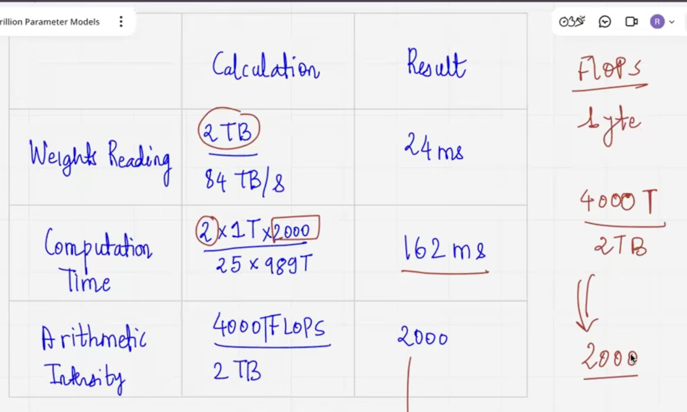

#### [How are Trillion Parameter Models Served](https://www.youtube.com/watch?v=UHC47KwOAO4) - TODO

#### Part-1: Arithmetic
* How much size does a 1T parameter model take?
* 1 Trillion = $10^{12}$ parameters
* Assuming BF16, each parameter is 2 bytes
* Total size = $10^{12} \times 2$ = 2T bytes (Equivalent to storage space in a laptop!)

***

* One H100 has high bandwidth memory (HBM) of 80 GB
* So, we need $\frac{2 TB}{80 GB} = 25$ GPUs to fit model parameters
* **NOTE**: This is considering weights alone. In real deployments, along with the weights, we have KV Cache, activations algng with runTime buffers. So, we'll definately need more than 25 GPUs.

***

* 10:00

* Now, let us try to estimate how much time it will take us to to serve a single token for a 1T model?

* [H100](https://github.com/muarshad01/Kernel-Engg/blob/main/H100.md) - 989 TFLOPs/sec
* Total operations = 2 x parameters = 2 Trillion
* Total GPUs = 25
* Operations per GPU = 2T/25 = 0.08 Trillion
* Compute time per GPU = 0.08 / 989 = 0.08 ms

***

* 15:00

*** 

* There is a cap to the memeory speed = 3.35 TB/s
* Since we have 25 GPUS, we can transfer 25 x 3.35 = 83.75 TB/s
* So, total time it takes to transer model parameters= $\frac{2 ~TB}{83.85 TB/s}$ = 24 ms
* This would mean 99.7% of GPU time goes waiting!

***

| Number of users | Weight read time | Computation time |
|---|---|---|
| 1   | 24 ms | 0.08 ms |
| 32  | 24 ms | 2.6 ms  |
| 295 | 24 ms | 24 ms   |

* You can accomodate uptill 295 users!

***

<p align="center">
  
</p>

* 20:00

* GPU can perform 989 TFLOPs/s (operations per sec)
* Memory transfer rate = 3.35 TB/s
* Hence, for each byte of memory transferred, there are $\frac{989}{3.35} = 295$ FLOPs (operation per sec)
* In the time, memory delievers one byte, Tensor Cores can do 295 operations on it.
* If the job does fewer than 295 op/byte, the users sit idle waiting for data.

*** 

* 25:00

## Part-2: Life of a Request
* Every serving engine (vLLM/SGLang) runs the following loop
* prompt - tokenize - prefill - decode - stream

```
You past 2,000 token document and ask summarize this. The model writes a 500 token summary.
```

#### Phase-1: Prefill
* The model processes all 2,000 tokens in a single pass.


<p align="center">
  
</p>

In Prefill, what is important is TTFT = 160 ms (0.16 sec)
  
***

* 30:00

#### Phase-1: Decode
* The model writes the summary one token at a time.
* Time per output token (TPOT) = 24ms
* Total time = TTFT + 500*TPOT = 0.16 + 500x24 ms = 12.2 seconds

***

* 35:00

## Part-3: KV-Cache

#### KIMI K2 model
* 61 layers
* 64 attention heads

* 1 KV pair = 128 x 2B x 2 x 64 x 61 ~ 1MB
* To store one key and value for a token takes ~ 2MB
* for 128k token conversion ~ 262 GB

***

* Let us say, we have 32 GPU = 2,560 GB
* Out of this 2,000 GB is for weights alone, so out of 560 GB remaining
* For one use KV cache = 262 GB, so we can only server 1 user.

***

#### MQA
#### GQA
#### MLA

| When | What |
|---|---|
| June 20 | Linear Attention |
| Feb 21  | Delta Rule for Linear Attention |
| - Dec 23 <br> - May 24  | - Mamba <br> - Mamba2 |
| May 24  | Jamba |
| Dec 24  | Gated Delta Net (KIMI) |
| Sep 25  | Qwen-3 Next: Gated Delta Net + Full Attention |
| Oct 25  | Kimi Linear: KDA + MLA |
| 2026    | Kimi k3, Qwen-3.8; Mematron 3 Linear: bring hybrids to frontier |

#### Hybrid Linear Attention


